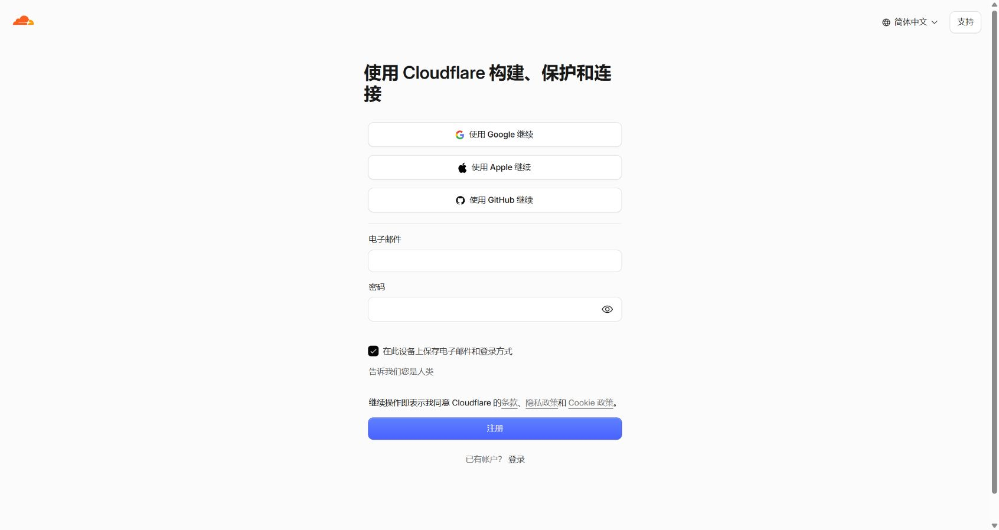
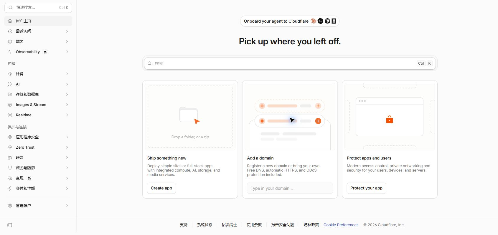
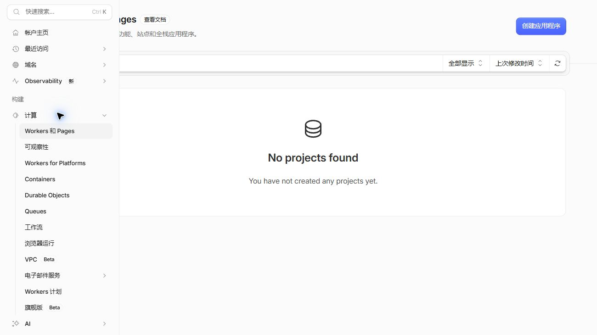
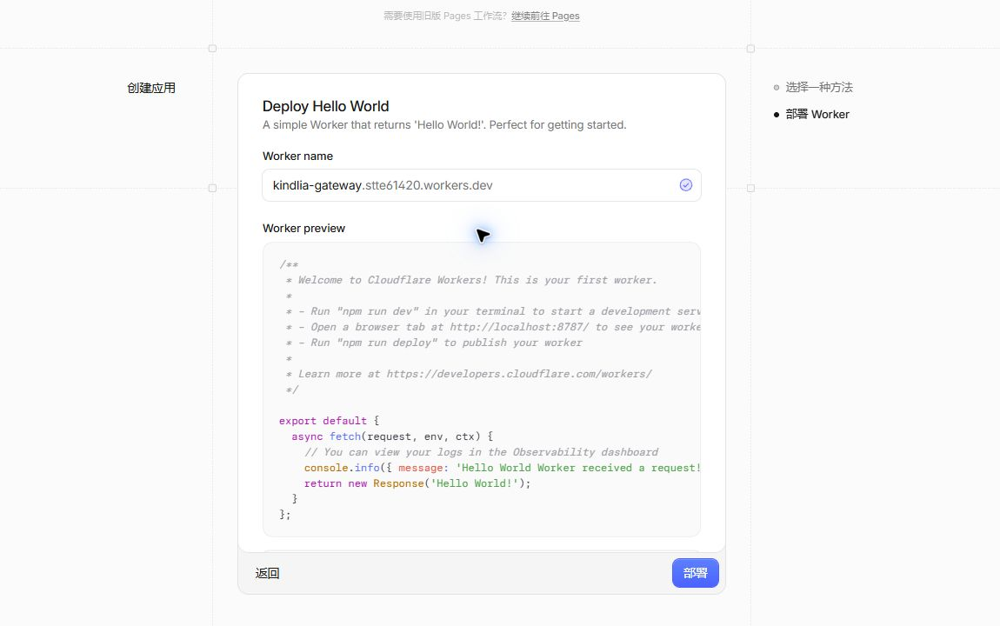
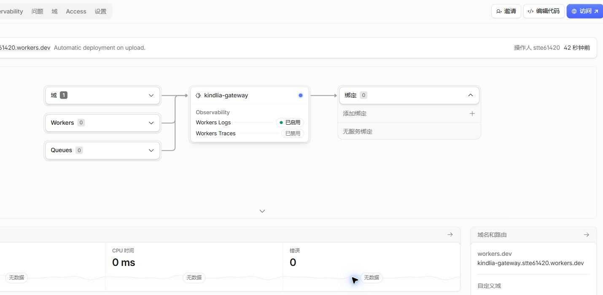
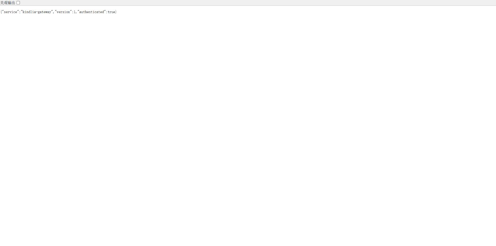
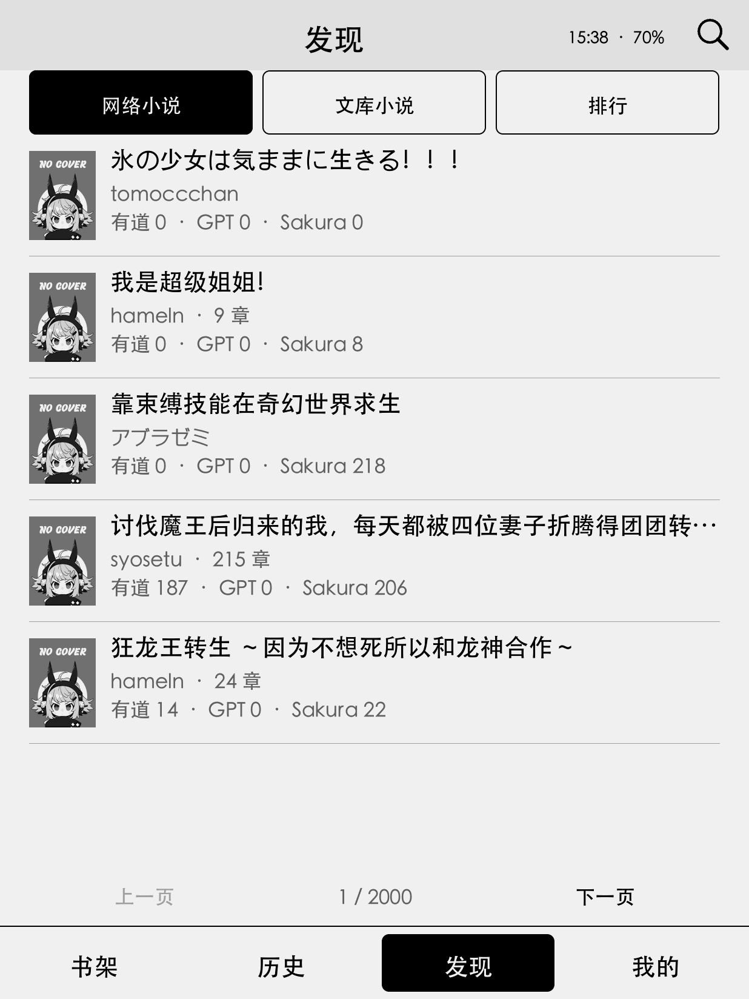

# Cloudflare 反代图文教程：没有自己的域名也能搭建

这篇教程从注册 Cloudflare 开始，直到在 Kindlia 中打开在线小说。使用 Cloudflare 自动分配的 `workers.dev` 地址，**不用购买域名，不用修改 DNS，也不用租服务器**。

Kindlia 默认直连。只有你填写自己的反代地址、密钥并打开开关后，才会经过 Worker。教程中的地址均为格式示例；截图中的演示地址也请换成控制台分配给你自己的地址。

> `workers.dev` 在部分中国大陆网络可能无法连接。部署成功不代表 Kindle 所在网络一定可达；请先完成第六步的连通检查。若电脑能访问、Kindle 不能访问，需要更换可达入口或网络，不能靠修改密钥解决。本文先不涉及自定义域名。

## 先看整个过程

```text
注册 Cloudflare → 验证邮箱 → 创建免费 Worker
                         ↓
                设置访问密钥和图片白名单
                         ↓
                发布 Kindlia 网关代码
                         ↓
                打开 /health 检查入口
                         ↓
          填写 Kindle 配置 → 重启应用 → 在线阅读
```

准备一台能访问 Cloudflare 和 GitHub 的电脑、一个能收信的邮箱，以及已安装 Kindlia 的 Kindle。网页编辑器可用时，只需浏览器；如果编辑器一直空白，第五步还提供官方 Wrangler 工具的备用发布方法，需要安装 Node.js。

你会接触到三种不同的密码或密钥，不要混用：

| 名称 | 用途 | 填在哪里 |
| --- | --- | --- |
| Cloudflare 登录密码 | 管理自己的 Cloudflare 账号 | Cloudflare 登录页 |
| 自己生成的网关密钥 | 防止其他人使用你的反代 | Worker 的 `GATEWAY_TOKEN`，以及 Kindle 的 `gateway_key`；两边完全相同 |
| Novelia 源站账号密码 | 登录小说网站，使用收藏和历史等功能 | Kindlia 的源站登录页 |

网关密钥由你自己生成，**不需要创建 Cloudflare API Token，也不要把 Cloudflare 登录密码填进 Kindle**。

## 一、注册 Cloudflare 并验证邮箱

1. 在电脑浏览器打开 [Cloudflare 官方注册页](https://dash.cloudflare.com/sign-up)。已有账号可直接登录。
2. 填写自己的邮箱和登录密码，按照页面提示完成人机验证，阅读并接受相应协议后点击 **注册 / Sign up**。
3. 打开邮箱，找到 Cloudflare 发来的验证邮件，点击其中的验证链接。收不到时，先检查垃圾邮件，再回控制台使用 **重新发送验证邮件 / Resend verification email**。
4. 回到 Cloudflare 控制台。如果仍弹出 **Verify your account**，说明邮箱验证尚未完成，先不要继续创建 Worker。



首次登录可能提示设置双重验证。可按自己的账号安全安排完成；它和网关访问密钥是两回事，不需要为了 Kindlia 关闭已有的双重验证。


进入首页后，**这条路线不需要点击 Add a domain，也不用输入自己的域名**。



> 如果注册或登录页提示 CAPTCHA 错误，却看不到验证框：正常刷新一次，检查网络及浏览器扩展是否拦截验证组件，或由本人完成验证后继续。不要反复点击注册，也不要绕过浏览器的证书警告。

## 二、创建一个免费 Worker

1. 在左侧展开 **计算 / Compute**，点击 **Workers 和 Pages / Workers & Pages**。
2. 在页面右上角点击 **创建应用程序 / Create application**。



3. 选择 **从 Hello World! 开始 / Start with Hello World!**。不用连接 GitHub，不选 Pages，也不用上传静态网站。


4. 将 Worker 名称改成 `kindlia-gateway`。若名称不可用，换一个自己容易记住的名称。
5. 保留页面默认的 `workers.dev` 地址。部分新账号会先要求设置一个 `workers.dev` 子域，按提示选一个可用名称即可；这是 Cloudflare 提供的地址，不是让你购买域名。
6. 本教程使用 Kindlia 的网关密钥鉴权，不额外开启 Cloudflare Access 登录保护；Kindle 原生客户端无法完成网页式 Access 登录。
7. 点击 **部署 / Deploy**，等待完成。



成功后会进入 Worker 概述页。记下自己的生产地址，例如：

```text
https://kindlia-gateway.your-account.workers.dev
```

其中 `your-account` 必须换成页面实际分配的子域；Worker 名称不同，地址的第一段也会不同。



现在访问地址只会看到 `Hello World!`，这是正常的，**还没有部署 Kindlia 反代代码**。

## 三、准备一份自己的网关密钥

建议生成一段 **32～64 位随机字母、数字及 `-_.~` 字符**，然后保存在自己可信的地方。不要使用邮箱密码、源站密码，也不要使用教程中的示例值。

Kindlia 接受 16～256 位、仅由英文字母、数字和 `-_.~` 组成的密钥。中文、空格、`+`、`/`、`=` 不在允许范围内。

如果你在 Windows 上没有现成的随机密码生成工具，可以在自己的 PowerShell 中运行下面这段命令。它只在本机生成随机内容，不会上传：

```powershell
$gatewayBytes = New-Object byte[] 24
$gatewayRng = [System.Security.Cryptography.RandomNumberGenerator]::Create()
$gatewayRng.GetBytes($gatewayBytes)
[Convert]::ToBase64String($gatewayBytes).Replace('+', '-').Replace('/', '_').TrimEnd('=')
$gatewayRng.Dispose()
```

复制输出的那一行。下一步填到 Cloudflare，之后还要原样填到 Kindle。这里不会提供一个所有人共用的密钥。

## 四、在 Worker 中添加两个变量

进入刚创建的 Worker，打开 **设置 / Settings**，找到 **运行时变量和密钥 / Runtime Variables and Secrets**，点击 **添加变量 / Add variable**。


### 4.1 添加 GATEWAY_TOKEN

按下面的表填写：

| 项目 | 填什么 |
| --- | --- |
| 环境 | 勾选 **生产 / Production** |
| 名称（当前中文界面显示为“密钥”） | `GATEWAY_TOKEN`，全部大写 |
| 值 | 第三步生成的自己的随机密钥 |
| 密钥 / Secret 复选框 | **勾选**；旧版界面可能是选择类型 `Secret` |

点击 **添加 1 个变量并部署 / Add variable and deploy**，等待完成。


保存后应显示 **值已加密 / Value encrypted**。之后 Cloudflare 不会再显示明文，所以要保存好自己生成的原值。

### 4.2 添加 IMAGE_HOSTS

再次点击 **添加变量**，名称填 `IMAGE_HOSTS`，值复制下面这一整行。它是公开的图片站白名单，**不用勾选密钥 / Secret**。

```text
*.mitemin.net,*.pximg.net,images-cn.ssl-images-amazon.cn,images-na.ssl-images-amazon.com,images-fe.ssl-images-amazon.com,m.media-amazon.com,images.amazon.com,cdn.kdkw.jp,*.bookwalker.jp,*.novelia.cc
```

这里不要加引号，不要写成 JSON 数组，也不要把网页代码块的反引号复制进去。然后点击 **添加 1 个变量并部署**。


最后应能看到两个名称：`GATEWAY_TOKEN` 和 `IMAGE_HOSTS`。前者的值已加密，后者能看到域名列表。


只添加到“预览”环境不够。Kindle 使用的是生产地址，务必核对 **生产** 标签页。

## 五、发布 Kindlia 网关代码

任选下面一种方式。**网页编辑器能打开就用 5A；编辑区持续空白或转圈就用 5B**。它们发布的是同一份源码，不需要两种都做。

### 5A：网页编辑器发布

1. 打开仓库的 [网关源码 index.js](https://github.com/mmnnwjw/Kindlia/blob/main/workers/kindlia-gateway/src/index.js)。
2. 点击文件右上角的 **Copy raw file / 复制原始文件**。不要使用页面顶端的 Copy path；那只会复制文件路径。
3. 也可以点击 **Raw**，在纯代码页面按 `Ctrl+A`、`Ctrl+C` 复制全部代码。


4. 回到 Cloudflare 的 Worker 概述页，点击右上角 **编辑代码 / Edit code**。
5. 等左侧编辑器加载完成，点击代码区域，按 `Ctrl+A` 全选原来的 Hello World 代码，再按 `Ctrl+V` 粘贴完整源码。
6. 保留文件名即可，不需要把自己的地址或密钥写进 JavaScript。
7. 点击右上角 **部署 / Deploy**，等待发布完成。只保存版本、只运行预览，都不等于发布到了生产地址。
8. 继续第六步。

代码应保留最后的 `export default`。如果编辑器报语法错误，先检查是否复制完整、是否误带了 Markdown 的三反引号。

### 5B：编辑器空白时，用官方 Wrangler 发布

这条备用路线需要电脑安装 Node.js，但不用安装 Python、Git 或 Rust，也不用申请 API Token。下面以 Windows 为例。

**① 安装 Node.js。** 从 [Node.js 官网](https://nodejs.org/zh-cn/download)下载 **LTS** 版本并安装。安装完成后重新打开 PowerShell，运行：

```powershell
node --version
npm.cmd --version
```

两条命令都能显示版本号才继续。使用 `npm.cmd`、`npx.cmd` 可以避免 Windows 把同名 `.ps1` 脚本拦下，不需要修改 PowerShell 执行策略。

**② 下载源码 ZIP。** 在 [Kindlia 仓库首页](https://github.com/mmnnwjw/Kindlia)点击 **Code → Download ZIP**，完整解压。注意：这里下载的是仓库源码 ZIP，**不是** Kindle 的 `kindlia-版本号.zip` 安装包；安装包中不含完整的 Worker 工程。

**③ 打开源码里的 `workers/kindlia-gateway/wrangler.jsonc`。** 用文本编辑器把：

```jsonc
"workers_dev": false,
```

改成：

```jsonc
"workers_dev": true,
```

保持 `"routes": []`，不要填写任何域名。`name` 应与第二步创建的 Worker 名称相同，默认就是 `kindlia-gateway`。保留其他配置，保存文件。

**④ 在这个目录打开 PowerShell。** 可以进入 `workers/kindlia-gateway` 文件夹，在资源管理器地址栏输入 `powershell` 并回车；也可以在终端用 `cd` 进入自己的实际解压路径，例如：

```powershell
cd "C:\Users\你的用户名\Downloads\Kindlia-main\workers\kindlia-gateway"
npm.cmd ci
npx.cmd wrangler login --scopes account:read user:read workers:write workers_scripts:write
```

路径只是示例，要替换成你实际解压的位置。`npm.cmd ci` 安装项目锁定的工具版本，等它结束后再执行登录命令。

**⑤ 在弹出的官方 Cloudflare 网页授权。** 核对页面显示的应用由 Cloudflare 管理、选中的是刚才创建 Worker 的账号，然后点击 **Authorize**。如果有多个账号，务必选择正确的一个。


看到 **Authorization granted to Wrangler** 后返回 PowerShell，不需要操作页面下面的 AI 工具提示。若登录命令提示授权超时，重新运行登录命令，再及时完成授权。

**⑥ 发布：**

```powershell
npx.cmd wrangler deploy --config wrangler.jsonc --keep-vars
```

等到命令显示 `Uploaded`、`Deployed`、生产 `https://...workers.dev` 地址和 `Current Version ID`。这才表示生产代码已发布。

`--keep-vars` 用于保留面板中的普通变量；生产环境的密钥也须继续存在。发布后回到设置页核对 `GATEWAY_TOKEN` 和 `IMAGE_HOSTS`，再做第六步检查。

> 本文这条无域名路线不要运行 `tools/deploy_gateway.py --deploy`：那个工具面向自定义域名，要求指定 `--domain`。也不要把 `workers_dev` 改回 `false` 后再次发布，否则会关闭这里使用的入口。

## 六、检查自己的入口是否可用

假设控制台给你的生产地址是：

```text
https://kindlia-gateway.your-account.workers.dev
```

在浏览器地址后加上 `/health`，打开：

```text
https://kindlia-gateway.your-account.workers.dev/health
```

正确响应应类似：

```json
{"service":"kindlia-gateway","version":1,"authenticated":true}
```



这里的 `authenticated: true` 表示 Worker 已配置访问密钥，**不是**浏览器已经登录源站，也不表示任何一个 Kindle 填写的密钥都正确。`/health` 本身不需要密钥。

| 你看到什么 | 说明与下一步 |
| --- | --- |
| `Hello World!` | 仍在运行示例代码，回第五步发布完整源码 |
| `authenticated: false` | 未配置生产 `GATEWAY_TOKEN`，回第四步核对环境与部署 |
| 根地址 `/` 返回 403 | 网关没有网站首页；配置密钥后，普通浏览器直接访问根路径被拒绝是正常的，检查用 `/health` |
| 浏览器直接打开小说 API 返回 403 | 浏览器没有携带 `X-Kindlia-Key` 请求头，不能据此判断网关坏了 |
| `/health` 也超时、DNS 或 TLS 报错 | 先解决当前网络对该 `workers.dev` 地址的访问，不要继续反复修改密码 |

健康检查通过后，下一步让 Kindlia 带上你的密钥访问真正的小说接口。

## 七、填写 Kindle 配置文件

### 7.1 先退出应用，再备份

1. 在 Kindle 的 Kindlia 中进入 **我的 → 退出应用**。不要只按电源键休眠。
2. 用 USB 将 Kindle 连接电脑，打开 Kindle 磁盘。
3. 找到 `extensions/kindlia/config.toml`。这就是设备中的 `/mnt/us/extensions/kindlia/config.toml`。
4. 在同一个 `kindlia` 文件夹下的 `backups/` 中保存一份配置副本，例如 `backups/config-before-gateway.toml`。已有同名备份时换一个名字，保留原备份。

```text
Kindle 磁盘
└─ extensions
   └─ kindlia
      ├─ config.toml                ← 修改这个文件
      ├─ config.example.toml        ← 模板，不是正在使用的配置
      ├─ backups
      │  └─ config-before-gateway.toml
      ├─ bin
      ├─ data
      └─ cache
```

如果找不到 `config.toml`，先安全弹出 Kindle，启动 Kindlia 一次并正常退出，再连接电脑。不要为了配置反代删除账号、缓存或阅读进度。

### 7.2 只修改这三个字段

用支持 UTF-8 的文本编辑器打开 `config.toml`，找到并修改下面三个字段。**同一个字段只保留一处**，不要在文件末尾又追加一组同名字段。

```toml
gateway_enabled = true
gateway_url = "https://kindlia-gateway.your-account.workers.dev"
gateway_key = "REPLACE_WITH_YOUR_OWN_GATEWAY_KEY"
```

- `gateway_url` 换成自己的生产根地址，保留 `https://`，不加 `/health`、`/main` 或 `/api`。
- `gateway_key` 换成第三步生成、第四步填入 `GATEWAY_TOKEN` 的同一段密钥，大小写也要一致。
- `gateway_enabled` 使用小写 `true`，不加引号；`"true"` 是字符串，不是开关。
- 地址与密钥使用英文半角双引号，不用中文引号。
- 保存时保持 UTF-8，文件名必须仍是 `config.toml`，不能变成 `config.toml.txt`。

下面三个源站地址**保持原值，不要换成 Worker 地址**：

```toml
api_base_url = "https://n.novelia.cc"
auth_base_url = "https://auth.novelia.cc"
forum_base_url = "https://forum.novelia.cc"
```

Kindlia 会自动在传输时选择小说、登录、评论和图片的转发路径。`forum_base_url` 在这里仅供书籍评论使用，不接入论坛页面。

### 7.3 重新启动，并核对设置

保存后安全弹出 Kindle，从 KUAL 重新启动 Kindlia。进入 **我的 → 设置 → 网络**，核对：

- 反代开关：开；
- 反代地址：自己的 `https://...workers.dev` 地址；
- 反代密钥：已设置；
- 离线模式：关。

也可以在这个设置页直接填写地址和密钥，再开启反代。填写顺序为 **地址 → 密钥 → 开关**，不要只打开开关而留空另外两项。


## 八、用实际内容检查

1. 打开 **发现 → 网络小说**，等待书目加载；点击一本以前没有缓存过的书，进入详情后打开正文。
2. 有源站账号时，仍在 Kindlia 原来的登录页登录。Cloudflare 账号不用于登录小说网站。
3. 打开 **文库小说**，进入书籍详情并选择某一卷。首次需要下载完整 EPUB，等待下载和解析完成后才会进入阅读器。
4. 有封面的书还应能显示封面；只看得到文字、图片始终失败时，回第四步检查 `IMAGE_HOSTS`。



旧缓存能打开不能证明反代可用。请选择没读过的在线内容，或进行一次新的搜索。首次 EPUB 下载也不要用浏览器的 `/health` 结果替代验收。

## 常见问题

| 现象 | 排查方法 |
| --- | --- |
| Kindle 提示 `Invalid gateway key` / HTTP 403 | 检查开关是否开启、客户端密钥是否与生产 `GATEWAY_TOKEN` 一致，是否误用了 Cloudflare 登录密码 |
| 提示 `Set the GATEWAY_TOKEN Worker secret first` / HTTP 503 | 检查是否漏填密钥、只部署到了预览环境，或误拼了变量名 |
| 列表能加载，封面或插图失败 | 检查 `IMAGE_HOSTS`；新增图片站需添加对应的精确域名或明确的 `*.suffix`，不要使用任意主机通配 |
| 登录失败但匿名书目正常 | 先核对源站账号和源站服务状态；Cloudflare 登录成功与源站登录成功是两回事 |
| 502 / `Upstream connection failed` | Worker 到源站的连接失败；稍后重试，核对源站是否正常，不要关闭 TLS 校验 |
| 单本小说正文返回 500 / `从源站获取失败` / `Tunnel failed` | 可能是源站抓取该小说发布站失败；先换一本已翻译的小说检查。若其他书正常，不要因此重置网关或账号 |
| 404 / `Route or method not allowed` | 确认部署的是完整网关源码；它不是任意网址代理，也不是普通网页镜像 |
| Worker 已部署，只有某台设备超时 | 分别检查电脑与 Kindle 所在网络能否访问该 `workers.dev` 入口；电脑的代理通常不会自动作用于 Kindle |
| 第一次文库下载较慢 | EPUB 可能有数 MB，受网络影响；确认实际进度，等待完成，不要把下载提示当作已经进入阅读器 |
| 编辑器和预览一直空白 | 正常刷新后仍不恢复，使用第五步 5B；不要凭空等待或认为已经发布了源码 |
| 提示每天请求数达到上限 / Error 1027 | 在控制台查看 Free 用量，等待 UTC 零点重置；个人共享同一账号的其他 Worker 也会消耗额度 |

### 暂时关闭或恢复

在 **我的 → 设置 → 网络** 关闭反代开关，或退出应用后把 `gateway_enabled` 改回 `false`，即可恢复直连。无需删除缓存、账号和进度。若配置文件写错导致无法启动，退出应用，用 `backups/` 中的配置副本恢复后重新启动。

### 以后更新网关代码

网页方式重新复制最新 `index.js` 到原 Worker 并部署；Wrangler 方式在自己的源码目录更新代码后重新发布。继续保留 `workers_dev = true`、自己的密钥和图片白名单。不要把自己的密钥、登录令牌或生成的客户端配置提交到 GitHub。

## 免费额度与参考资料

Cloudflare Workers Free 当前每日额度为 **100,000 次请求，UTC 零点重置（日本时间 09:00）**，每次 HTTP 请求 CPU 时间额度为 10 ms，网络等待不计入 CPU。网关不需要 KV、R2、D1 等存储绑定，不需要为了本教程升级到付费计划。实际用量以自己控制台为准；域名和网络可达性也不由免费额度保证。[官方限制说明](https://developers.cloudflare.com/workers/platform/limits/)

- [Cloudflare：从控制台创建 Worker](https://developers.cloudflare.com/workers/get-started/dashboard/)
- [Cloudflare：workers.dev 地址](https://developers.cloudflare.com/workers/configuration/routing/workers-dev/)
- [Cloudflare：运行时密钥](https://developers.cloudflare.com/workers/configuration/secrets/)
- [Cloudflare：Wrangler 登录与发布](https://developers.cloudflare.com/workers/wrangler/commands/)
- [Kindlia 网关源码](../workers/kindlia-gateway/src/index.js)

本文控制台图片来自真实操作。Kindle 界面示例使用 KPW5 / 固件 5.17.1 的隔离模拟器；它能验证配置读取、请求与原生页面流程，不能代表各地真实 Kindle 网络的可达性。
