# Cloudflare 反代搭建教程

这篇教程面向零基础新手，从注册 Cloudflare 与免费域名开始，一步步搭建属于你自己的专属小说加速通道。

全程 **0 成本**、**无需购买域名**、**无需租用服务器**、**无需备案**，跟着图文点击即可轻松复现。

---

## 先看整个搭建流程

```text
注册 Cloudflare 账号 → 获取 DigitalPlat 免费域名 (如 .dpdns.org)
                             ↓
             将免费域名委派托管到 Cloudflare (修改名称服务器)
                             ↓
             创建免费 Worker 并发布 Kindlia 网关源码
                             ↓
             配置访问密钥 (GATEWAY_TOKEN) 与图片白名单 (IMAGE_HOSTS)
                             ↓
             为 Worker 绑定免费自定义域名 (彻底绕开 workers.dev 污染)
                             ↓
             在浏览器打开 /health 检查专属网关状态
                             ↓
    填写 Kindle 客户端配置 (config.toml) → 重启应用 → 畅快阅读在线小说
```

---

## 账号与密钥速查表（清晰区分，避免混淆）

在配置过程中，你会接触到几种不同的账号、密码与口令，它们各司其职，请对照下表：

| 名称 | 用途 | 获取途径 / 填在哪里 |
| --- | --- | --- |
| **Cloudflare 账号** | 管理 DNS 解析、部署 Worker 脚本与配置自定义域 | [Cloudflare 官网](https://dash.cloudflare.com/sign-up) 注册 |
| **DigitalPlat 账号** | 申请并持有免费域名（如 `.dpdns.org`），配置 DNS 委派 | [DigitalPlat 官网](https://digitalplat.org) 注册并用 GitHub 验证 |
| **自己生成的网关密钥** | 保护你的反代网关，防止外部陌生人蹭用消耗额度 | Worker 的 `GATEWAY_TOKEN`，以及 Kindle 的 `gateway_key`（两处必须完全一致） |
| **Novelia 源站账号** | 登录小说网站，同步收藏书架与历史进度（非必须） | 仅在 Kindlia 客户端内的源站登录页输入（切勿填进 Cloudflare！） |

---

> [!CAUTION]
> 建议全程在Chrome浏览器无痕式窗口内完成以免遇到问题

## 一、注册 Cloudflare 账号并验证邮箱

1. 在电脑浏览器打开 [Cloudflare 官方注册页](https://dash.cloudflare.com/sign-up)。已有账号直接登录即可。
2. 填写常用邮箱和密码，完成人机验证后点击 **注册 / Sign up**。
3. 登录你的注册邮箱，查收 Cloudflare 发来的验证邮件，点击其中的激活链接完成邮箱验证。
4. 回到 Cloudflare 控制台，确认账号无“未验证邮箱”的警告横幅。


*图 1：Cloudflare 注册页面*

首次登录时可能会提示设置双重验证（2FA），按照个人偏好设置或暂不设置均可。

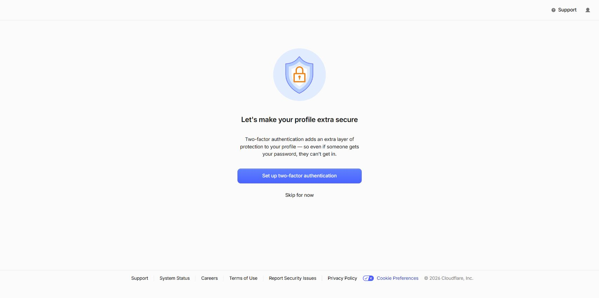
*图 2：双重验证提示（按需选择）*

> 此时控制台首页会看到“添加域名”按钮，**先不要急着点击添加**，我们先在下一步免费申领一个属于自己的二级域名。

---

## 二、免费获取专属二级域名（DigitalPlat）

> **若已有域名可跳过此步骤**

Cloudflare 默认的 `workers.dev` 在国内被污染，所以我们需要一个正常的域名作为流量入口。这里推荐使用 **DigitalPlat** 提供的免费域名服务（支持完整的 DNS NS 委派，完全免费）。

1. 打开 [DigitalPlat 平台官网](https://digitalplat.org) 注册账号并登录。
2. 首次进入工作区，在“您想先做什么？”向导中，点击选择 **【获取域名】**（找到一个名称并将其连接到您的项目）。
   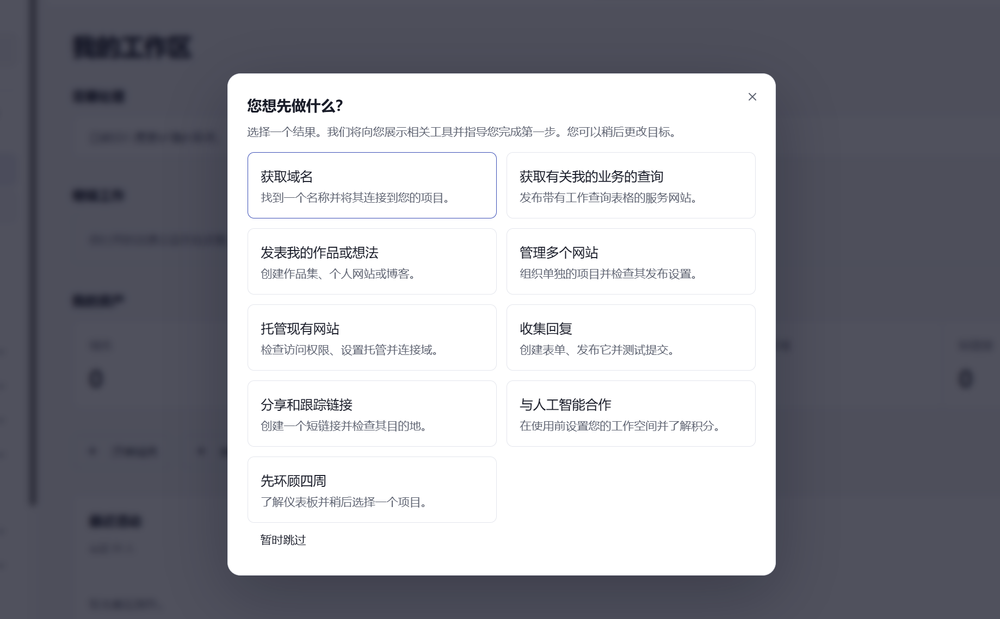
   *图 3：DigitalPlat 向导页，点击“获取域名”*

3. 在计划向导中，下拉选择 **【只需要必要的步骤】**，然后点击 **【开始我的指导设置】**。
   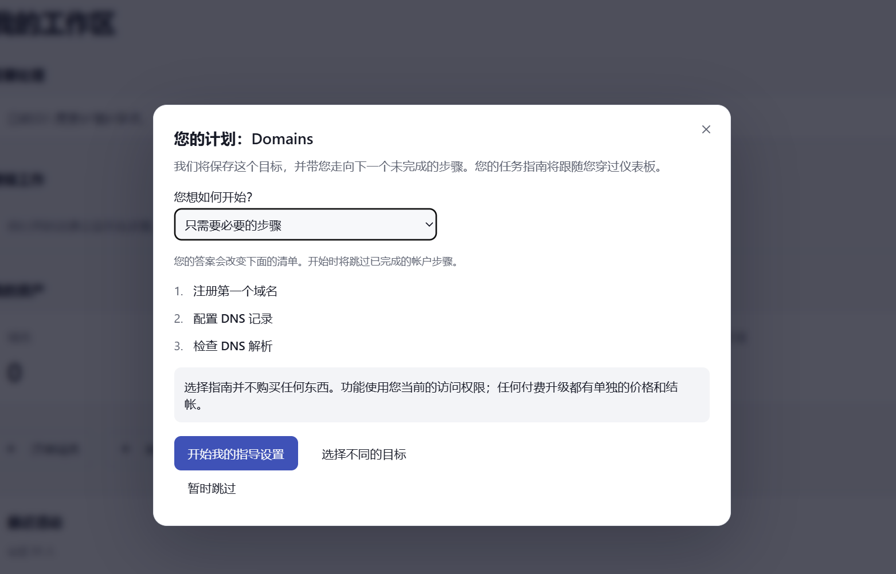
   *图 4：选择“只需要必要的步骤”并点击开始设置*

4. 进入左侧菜单【资产 → 域名 → 注册域名】。页面底部展示了平台提供的免费后缀：包含 `.dpdns.org`（免费 · $0.00）、`.us.kg`（免费 · $0.00）等。
   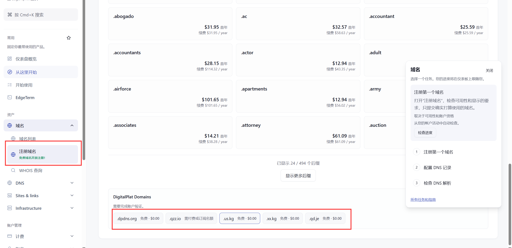
   *图 5：免费域名开放注册列表*

5. 点击进入 **【DigitalPlat Domains】** 选项卡：
   - 在搜索框中输入你喜欢的域名前缀（例如 `kindletest11`，建议由英文字母和数字组成）；
   - 右侧后缀选择 **`.dpdns.org`**；
   - 勾选底部的“我已认真阅读并同意上述所有适用政策和服务条款”；
   - 点击右侧蓝色的 **【检查可用性】**。
   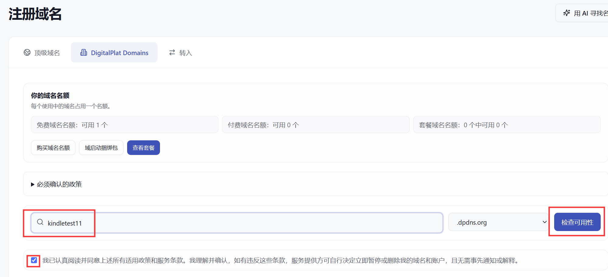
   *图 6：输入域名前缀并检查可用性*

6. 弹窗提示“免费域名可注册”：
   - **委派模式**：务必选择右侧红框中的 **【稍后配置】**（先注册域名，稍后再委派给 Cloudflare）；
   - **本次使用名额**：保持选中“免费域名名额”；
   - **账户验证**：免费名额需要完成一次账户验证，点击黄色提示框内的 **【验证账户】**（绑定授权一次你的 GitHub 账号（刚注册的也行）即可通过）；
   - 验证通过后，点击弹窗右下角蓝色的 **【注册】** 按钮。
   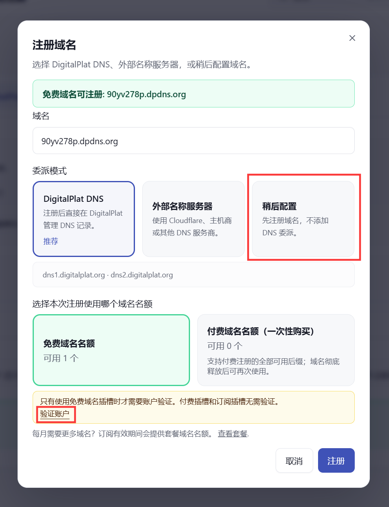
   *图 7：委派模式选“稍后配置”，完成账户验证后点击注册*

7. 注册成功后，会自动进入该域名的管理详情页（例如 `管理 90yv278p.dpdns.org`）：
   - 记下自己的完整域名（示例为 `90yv278p.dpdns.org`）；
   - 在【名称服务器】选项卡下方，留有【* 名称服务器 1】和【* 名称服务器 2】输入框；
   - **先保留该网页不要关闭**，接下来我们前往 Cloudflare 获取要填入的名称服务器地址。
   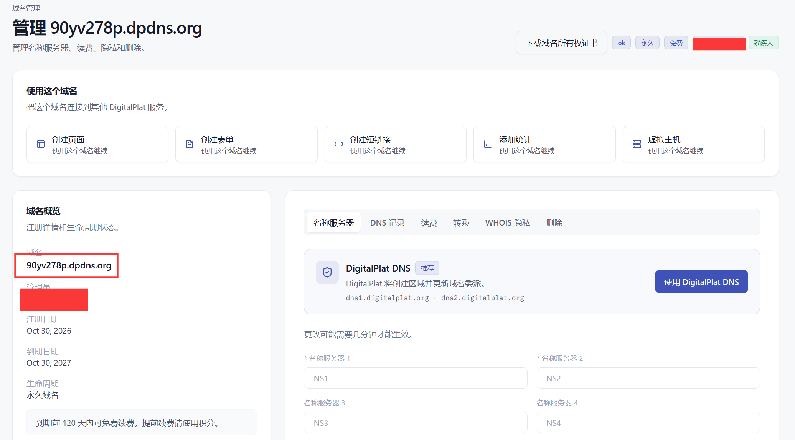
   *图 8：域名管理页面，等待填入名称服务器*

---

## 三、将免费域名托管至 Cloudflare（配置 DNS 委派）

把域名的 DNS 解析权交给 Cloudflare，这样 Cloudflare Worker 才能直接绑定该域名，并由 Cloudflare 自动签发 HTTPS 证书。

1. 打开 Cloudflare 控制台，在左侧菜单展开 **【域名 / Domains】** → 点击 **【概览】**，然后点击页面右上角的蓝色 **【添加域名 / Add domain】** 按钮。
   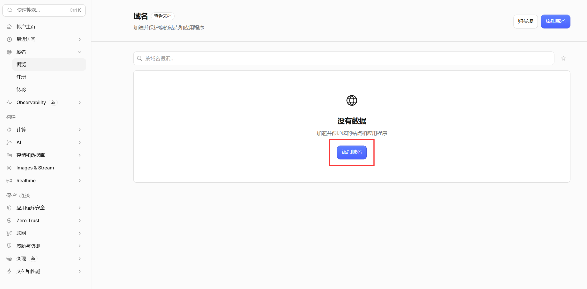
   *图 9：Cloudflare 控制台点击“添加域名”*

2. 在“添加站点”页面中，选择第一项 **【连接域名】**（让您的站点更快、更安全、更可靠）。
   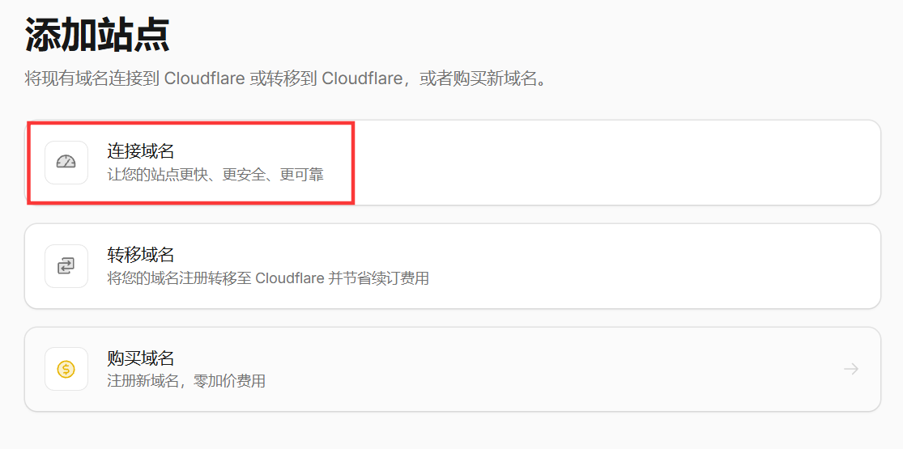
   *图 10：点击选择“连接域名”*

3. 输入你在 DigitalPlat 申请的完整域名（例如 `90yv278p.dpdns.org`）：
   - 在下方的“额外配置”中，建议将【搜索】、【代理】、【训练】均切换为 **【阻止】**（防止爬虫消耗个人额度，保障私有网关安全）；
   - 点击右下角的 **【继续】**。
   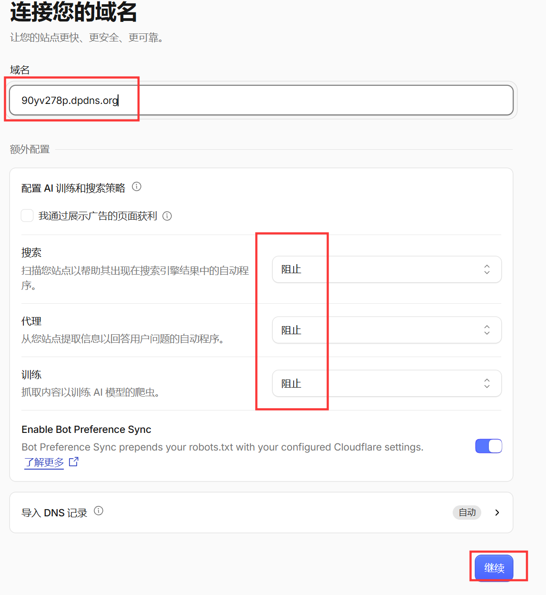
   *图 11：输入完整域名，安全策略选择阻止，点击继续*

4. 进入“选择计划”页面：
   - 选中最左侧的 **【免费 US$0 / Free $0】** 计划卡片；
   - 点击该卡片下的 **【选择计划】**（完全免费，无需绑定信用卡）。
   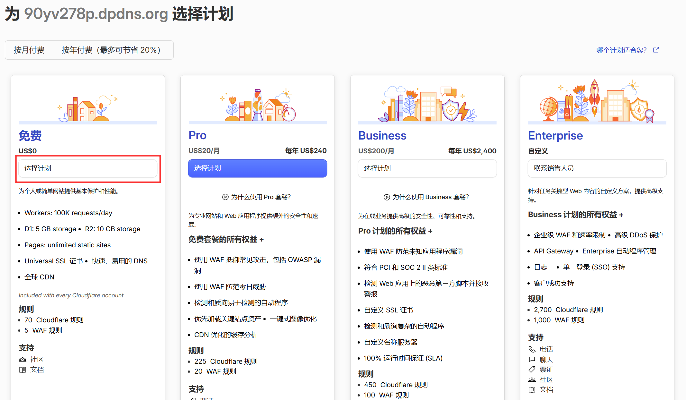
   *图 12：选择免费计划*

5. 进入“DNS 记录”检视页面：
   - 全新域名无记录属正常现象，**不需要手动添加任何记录**；
   - 直接滑到页面最底部，点击蓝色的 **【继续前往激活】**。
   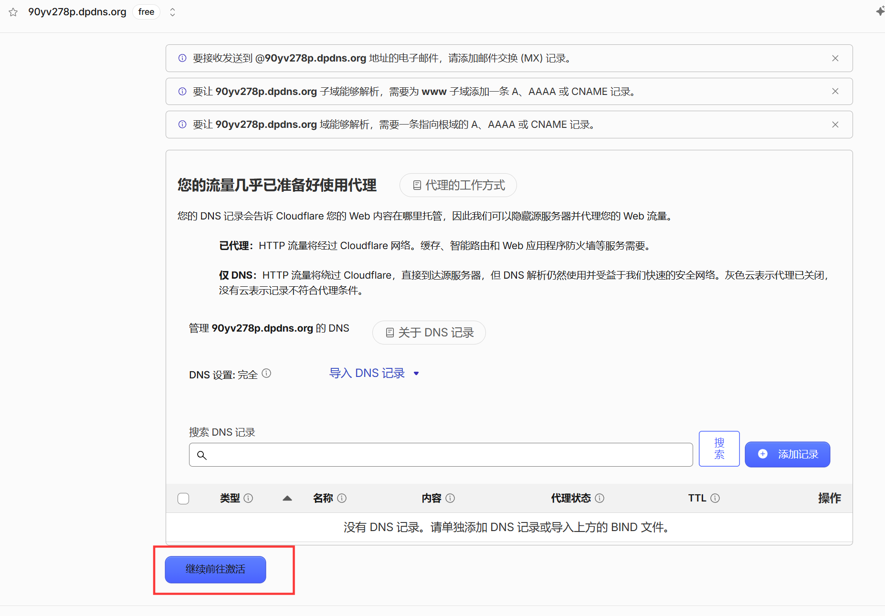
   *图 13：无需添加任何记录，直接点击“继续前往激活”*

6. Cloudflare 会展示分配给你的专属名称服务器地址（Nameservers），通常格式如下：
   - `ara.ns.cloudflare.com`
   - `clayton.ns.cloudflare.com`
   *(注意：每个人分配到的名称服务器前缀可能不同，请以你屏幕显示的实际地址为准，点击右侧图标复制)*
   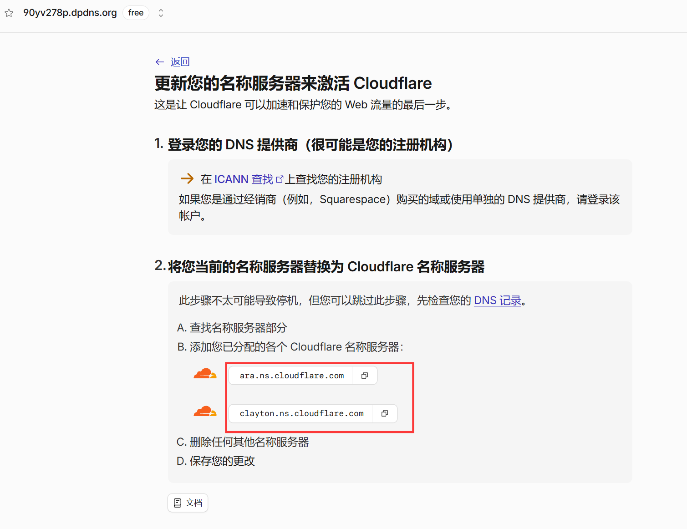
   *图 14：复制 Cloudflare 分配给你的两台名称服务器*

7. 回到 DigitalPlat 域名管理页面的 **【名称服务器】** 选项卡：
   - 将上面两行 Cloudflare 地址分别粘贴到 **【* 名称服务器 1】** 和 **【* 名称服务器 2】**；
   - 检查前后无多余空格，点击右下角蓝色的 **【更新名称服务器】** 保存生效。
   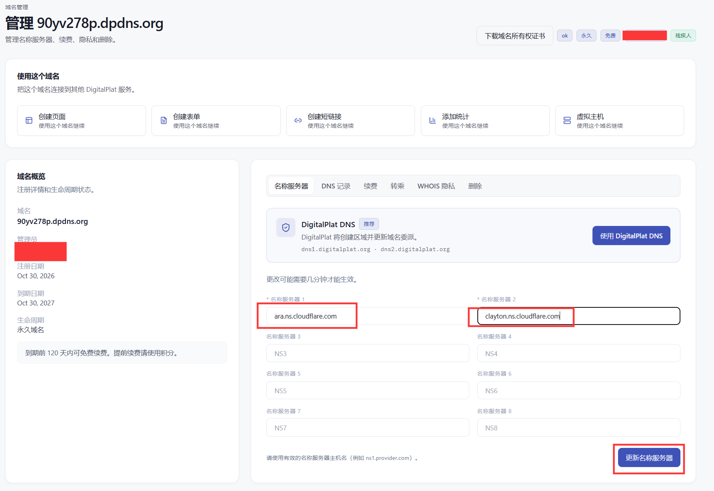
   *图 15：将 Cloudflare 地址粘贴至 DigitalPlat 并更新*

8. 稍候片刻（一般 1~3 分钟全球 DNS 生效），回到 Cloudflare 刷新该域名的概览页：
   - 看到绿色对勾提示 **【您的域现在受 Cloudflare 保护】**，说明域名托管彻底成功！
   - 同时在右侧面板中，能看到【未连接 Workers】和醒目的 **【创建 Worker】** 按钮。
   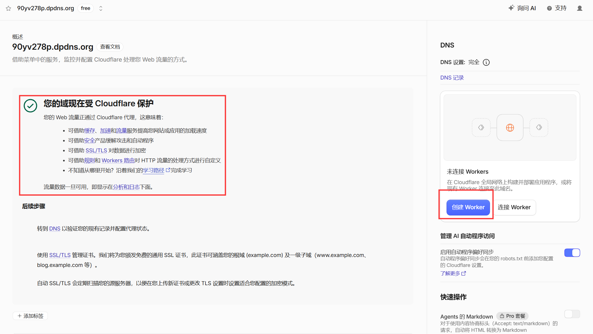
   *图 16：DNS 委派成功，右侧面板可一键点击“创建 Worker”*

---

## 四、创建免费 Worker 并发布 Kindlia 网关代码

现在我们来创建负责请求代理与图片转发的 Worker。

### 4.1 创建初始 Worker
- **极简入口**：直接在图 16 右侧面板点击蓝色的 **【创建 Worker】**；
- 或者从 Cloudflare 控制台左侧菜单点击 **【计算 / Compute】** → **【Workers 和 Pages】**，点击右上角 **【创建应用程序 / Create application】**。
  
  *图 17：点击“创建应用程序”*

- 选择 **【从 Hello World! 开始 / Start with Hello World!】**。
  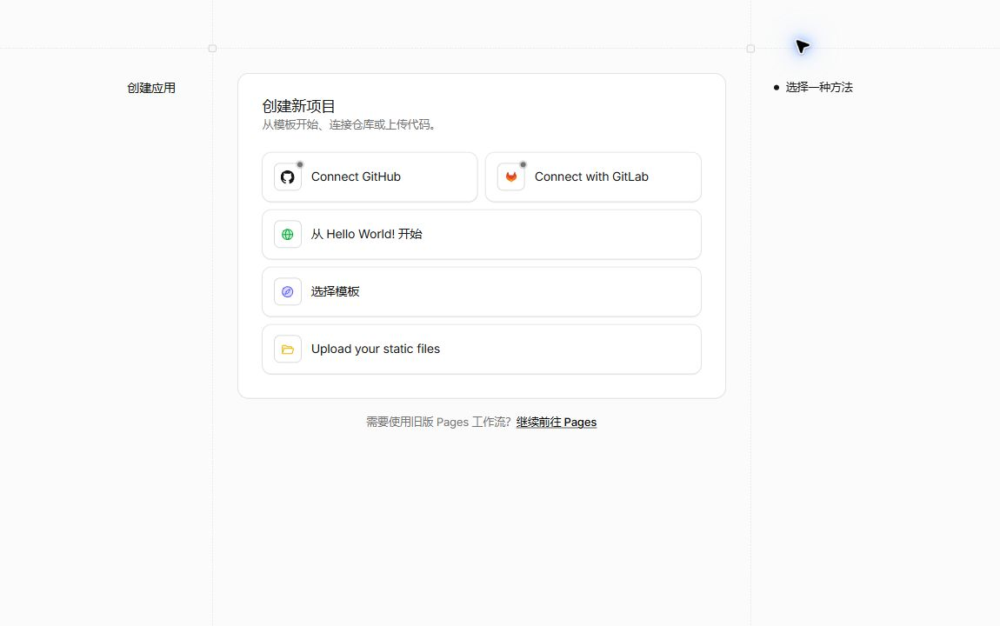
  *图 18：选择 Hello World 作为起点*

- 将 Worker 名称修改为 `kindlia-gateway`（若重名可自定义，例如 `my-kindlia-gateway`）。
- 底部选项保持默认，点击 **【部署 / Deploy】**。
  
  *图 19：修改名称并部署*

部署完成后，进入 Worker 概览页面。

---

### 4.2 发布 Kindlia 网关源码

#### 推荐方式：网页编辑器直接发布（无需安装任何工具）

1. 打开网关源码文件：[Kindlia 网关源码 index.js](https://github.com/mmnnwjw/Kindlia/blob/main/workers/kindlia-gateway/src/index.js)。
2. 点击文件右上角的 **【Copy raw file / 复制原始文件】** 按钮（或点击 `Raw` 纯文本页面后 `Ctrl + A`、`Ctrl + C` 复制全部内容）。
   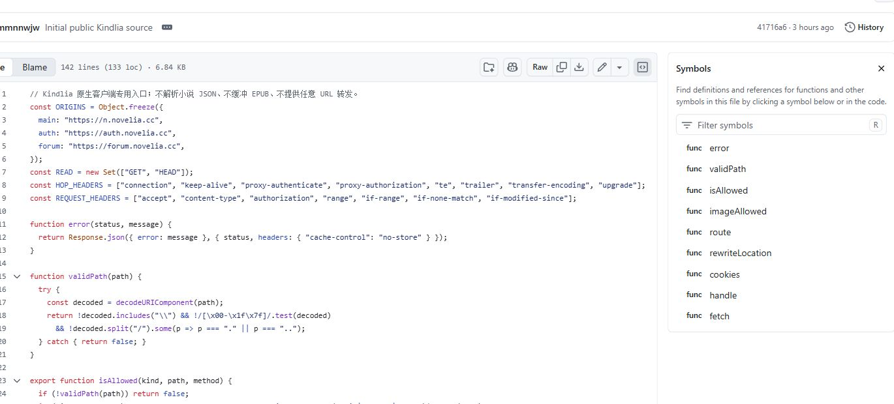
   *图 20：点击 Copy raw file 复制全部代码*

3. 回到 Cloudflare 控制台刚部署好的 Worker 概览页面，点击右上角 **【编辑代码 / Edit code】** 按钮。
4. 在左侧的代码编辑器中，按键盘 `Ctrl + A` 全选原来的 Hello World 示例代码，按 `Delete` 清空。
5. 按 `Ctrl + V` 粘贴刚刚复制的完整网关源码。
6. 点击右上角醒目的蓝色 **【部署 / Deploy】** 按钮，等待右上角弹出部署成功提示。

> 粘贴的代码开头应包含路由处理逻辑，结尾包含 `export default { ... }`。无需将自己的域名或密钥写死在代码中，下一步我们在系统变量中统一配置。

---

> #### 备用方式：若网页编辑器白屏，使用 Wrangler 命令行发布
> 若因本地网络原因 Cloudflare 网页编辑器一直转圈或无法加载，可使用官方命令行工具：
> 1. 电脑安装 [Node.js LTS](https://nodejs.org/)。
> 2. 打开 PowerShell，进入网关工程目录并运行：
>    ```powershell
>    npm.cmd ci
>    npx.cmd wrangler login
>    ```
>    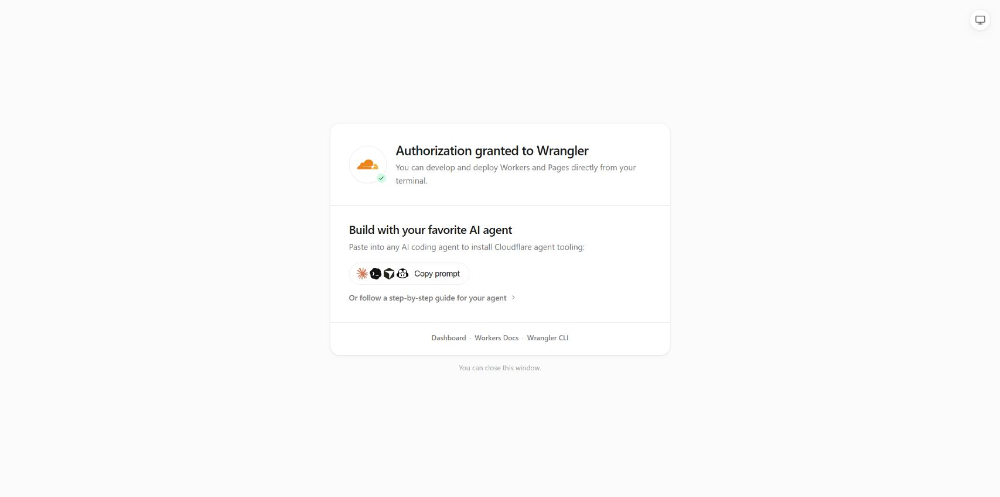
>    *图 21：Wrangler 官方网页授权*
> 3. 授权成功后，运行发布：
>    ```powershell
>    npx.cmd wrangler deploy --keep-vars
>    ```

---

## 五、配置网关运行时密钥与图片白名单

我们需要为 Worker 添加两个环境变量：
1. `GATEWAY_TOKEN`：你的私有网关访问密码（加密存储）。
2. `IMAGE_HOSTS`：小说封面与文库插图的图床白名单（公开变量）。

### 5.1 生成专属的高强度网关密钥
网关密钥用于防止其他人盗用你的网关额度。建议生成一段 32~64 位的随机字符串。在 Windows PowerShell 中运行下面一行命令即可在本地安全生成一段高强度密钥：

```powershell
$b = New-Object byte[] 24; [System.Security.Cryptography.RandomNumberGenerator]::Create().GetBytes($b); [Convert]::ToBase64String($b).Replace('+','-').Replace('/','_').TrimEnd('=')
```

复制输出的那一串随机文本（例如 `W7k_vL2vP0mN8bV5cZ1xW7-A3`），先保存在记事本中。

---

### 5.2 在 Worker 中添加两个变量

进入该 Worker 的管理页面，点击顶部导航栏中的 **【设置 / Settings】**，在左侧找到 **【运行时变量和密钥 / Runtime Variables and Secrets】**，点击 **【添加变量 / Add variable】**。
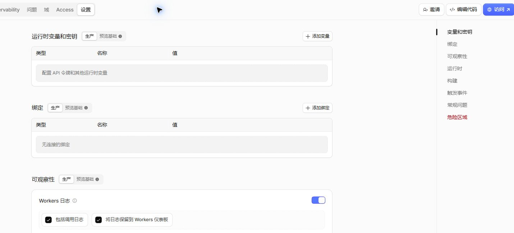
*图 22：添加运行时变量入口*

#### 变量 1：添加 `GATEWAY_TOKEN`（生产环境加密密钥）
按以下说明填写：
- **环境**：勾选 **【生产 / Production】**；
- **名称**：`GATEWAY_TOKEN`（必须全部大写）；
- **值**：粘贴刚刚生成的随机密钥；
- **密钥 / Secret 复选框**：务必 **【勾选】**（保存后 Cloudflare 将自动加密该值，不向外部泄露）；
- 点击 **【添加 1 个变量并部署 / Add variable and deploy】**。
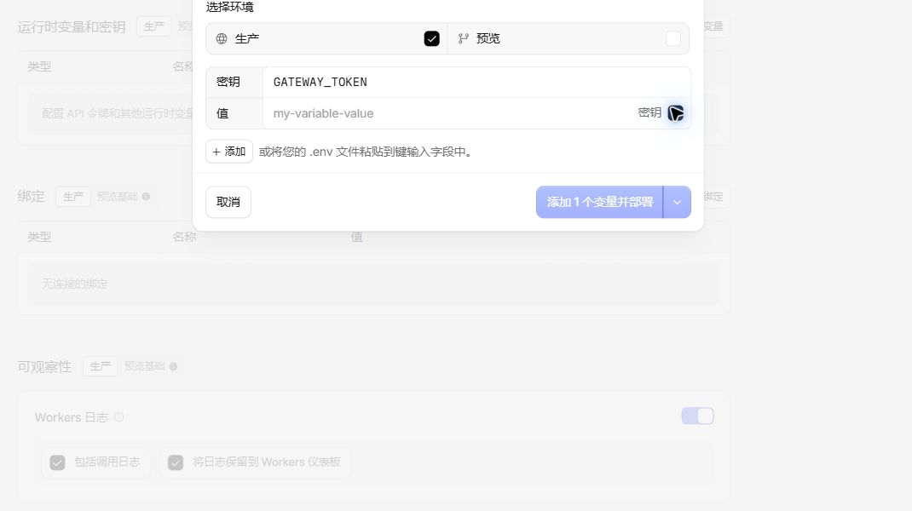
*图 23：添加 GATEWAY_TOKEN 并勾选加密*

#### 变量 2：添加 `IMAGE_HOSTS`（普通白名单变量）
再次点击 **【添加变量】**：
- **环境**：勾选 **【生产 / Production】**；
- **名称**：`IMAGE_HOSTS`（全大写）；
- **值**：复制并粘贴以下一整行图床域名列表：
  ```text
  *.mitemin.net,*.pximg.net,images-cn.ssl-images-amazon.cn,images-na.ssl-images-amazon.com,images-fe.ssl-images-amazon.com,m.media-amazon.com,images.amazon.com,cdn.kdkw.jp,*.bookwalker.jp,*.novelia.cc
  ```
- **密钥 / Secret 复选框**：**【不要勾选】**（普通明文变量即可）；
- 点击 **【添加 1 个变量并部署】**。
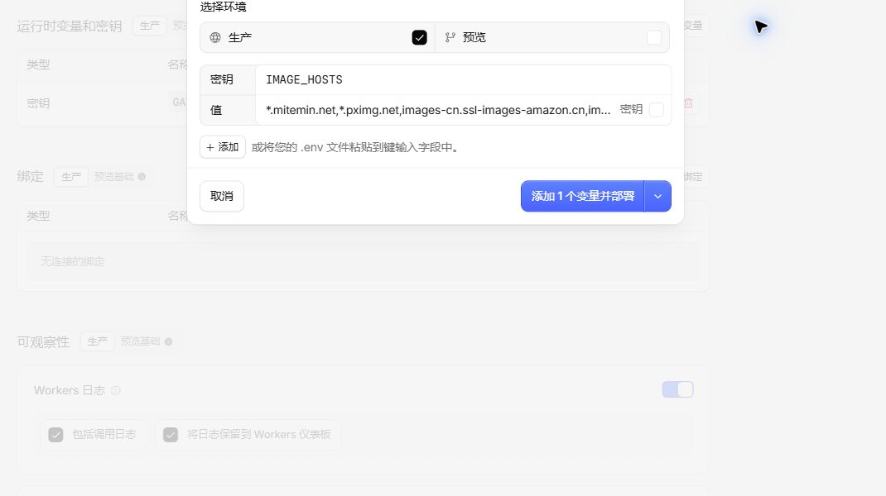
*图 24：添加 IMAGE_HOSTS 域名白名单*

最后核对变量列表，确认生产环境下包含 `GATEWAY_TOKEN`（显示为值已加密）与 `IMAGE_HOSTS` 两个条目。
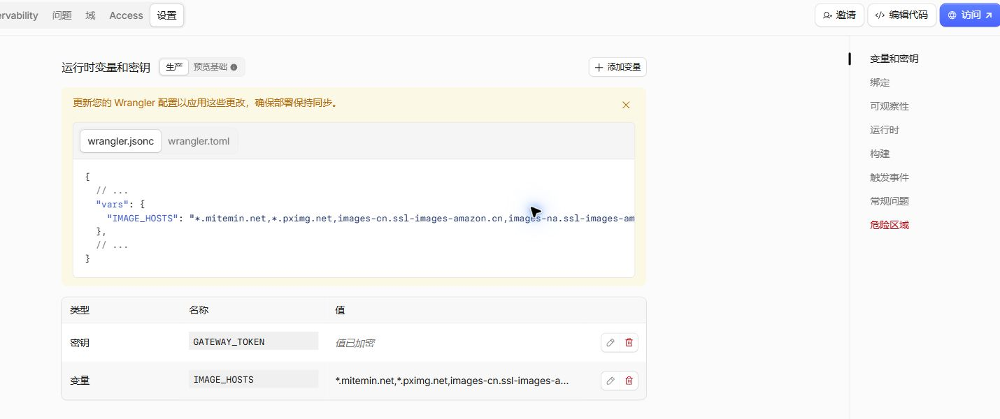
*图 25：核对变量保存状态*

---

## 六、将 Worker 绑定到免费自定义域名

1. 在当前 Worker 的管理页面中，点击顶部标签栏中的 **【域】**。
2. 找到“自定义域和路由”一栏，点击右侧蓝色的 **【+ 添加域名】** 按钮。
   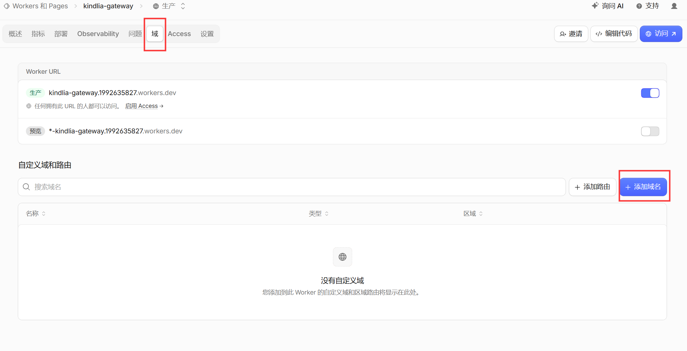
   *图 26：在 Worker 顶栏进入“域”，点击“+ 添加域名”*

3. 在弹出的“连接域名”窗口中，点击选中你在第二步已托管到 Cloudflare 的免费域名（例如 `eqnhvhiv2oyds3ajbv5ucrn8ip4t.dpdns.org`）。
   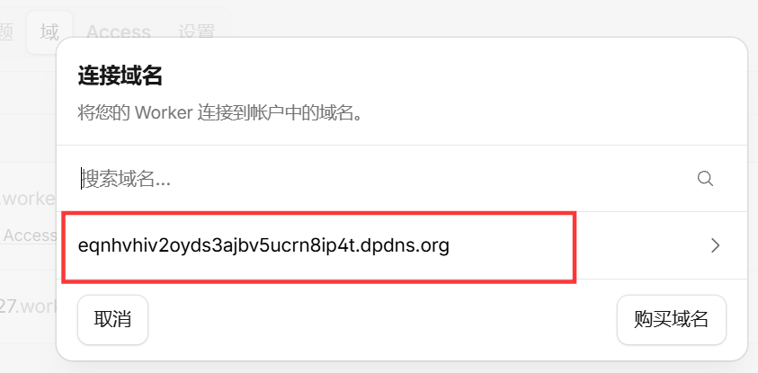
   *图 27：在连接列表中点击选中已托管的域名*

4. 进入“连接至该域名”设置界面：
   - 在 **子域名 (optional)** 输入框中，填写你喜欢的二级域名前缀，例如输入 `kindlia-gateway`（也可以留空直接使用根域名）；
   - **启用对象**：保持默认的“生产”环境；
   - 点击右下角蓝色的 **【添加域名】** 按钮。
   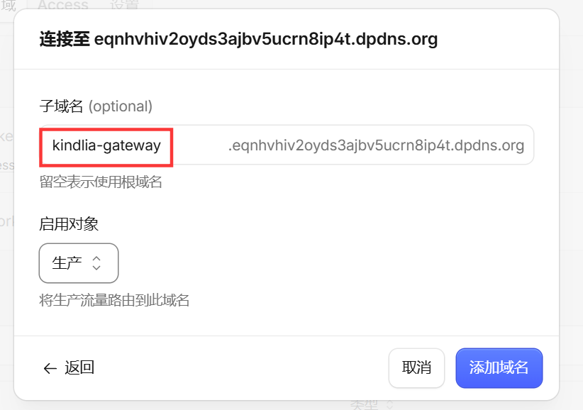
   *图 28：设置子域名前缀并确认添加*

5. 添加完成后回到 Worker 概览页面，顶部显示的正式访问入口已更新为你配置好的专属自定义域名（例如 `kindlia-gateway.eqnhvhiv2oyds3ajbv5ucrn8ip4t.dpdns.org`）。Cloudflare 会在后台全自动下发 SSL 证书并配置 DNS 解析，无需手动干预。
   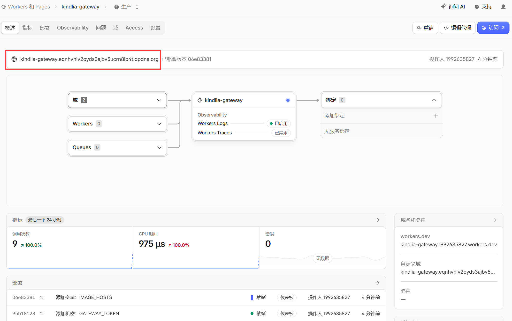
   *图 29：Worker 概览页确认自定义网关地址已生效*

---

### 6.1 验证网关连通性与健康状态

拿出你的电脑或手机浏览器，在你的自定义域名后加上 `/health` 打开访问：

```text
https://kindlia-gateway.your-domain.dpdns.org/health
```
*(注意：请将地址换成你自己绑定的实际完整域名！)*

如果一切正常，页面将立即返回如下 JSON 格式的健康状态：

```json
{"service":"kindlia-gateway","version":1,"authenticated":true}
```

> **返回结果诊断说明**：
> - `authenticated: true`：说明网关源码、密钥、SSL 证书及域名解析全部正常！
> - `authenticated: false`：说明未检测到密钥，请检查第五步的 `GATEWAY_TOKEN` 是否拼写错误，或是否漏勾了“生产”环境。
> - 直接访问域名根路径返回 403 是完全正常的安全防护表现，检查请统一使用 `/health`。

---

## 七、在 Kindle 客户端配置并启用网关

网关就绪后，最后一步是将你的专属网关地址填入 Kindle 客户端。

```text
Kindle 盘符
└─ extensions
   └─ kindlia
      ├─ config.toml  ← 需要修改的文件
      ├─ bin/
      └─ data/
```

> [!CAUTION]
> 安装Kindlia之后需要**至少启动一次**来生成`config.toml`

---

### 7.1 修改三个关键参数

使用支持 UTF-8 编码的文本编辑器（如 VS Code、Sublime Text 或 Notepad++，不要使用 Windows 原生记事本以免破坏文件编码）打开 `config.toml`，找到并修改以下三行：

```toml
gateway_enabled = true
gateway_url = "https://kindlia-gateway.your-domain.dpdns.org"
gateway_key = "W7k_vL2vP0mN8bV5cZ1xW7-A3"
```

- `gateway_enabled`：改为 `true`（必须全部小写，不带双引号）；
- `gateway_url`：填写你在第六步绑定的**自定义域名**，保留前缀 `https://`，**末尾千万不要加斜杠 `/` 或 `/health`**；
- `gateway_key`：填写第五步生成的专属密钥，必须与 Cloudflare 中 `GATEWAY_TOKEN` 完全一致。

> **保持源站原配置不动**：
> 文件中的这三个地址配置**请保持原样**（如果你不知道修改它们意味着什么的话）：
> ```toml
> api_base_url = "https://n.novelia.cc"
> auth_base_url = "https://auth.novelia.cc"
> forum_base_url = "https://forum.novelia.cc"
> ```

---

### 7.2 保存并重启 Kindlia
1. 保存 `config.toml` 文件。
2. 在电脑托盘安全弹出 Kindle 盘符，拔出 USB 数据线。
3. 在 Kindle 的 KUAL 启动器中重新打开 Kindlia。
4. 进入 **【我的】** → **【设置】** → **【网络】**，核对网络状态：
   - 反代开关：**开启**；
   - 反代地址：显示为你的自定义域名；
   - 反代密钥：显示为“已设置”；

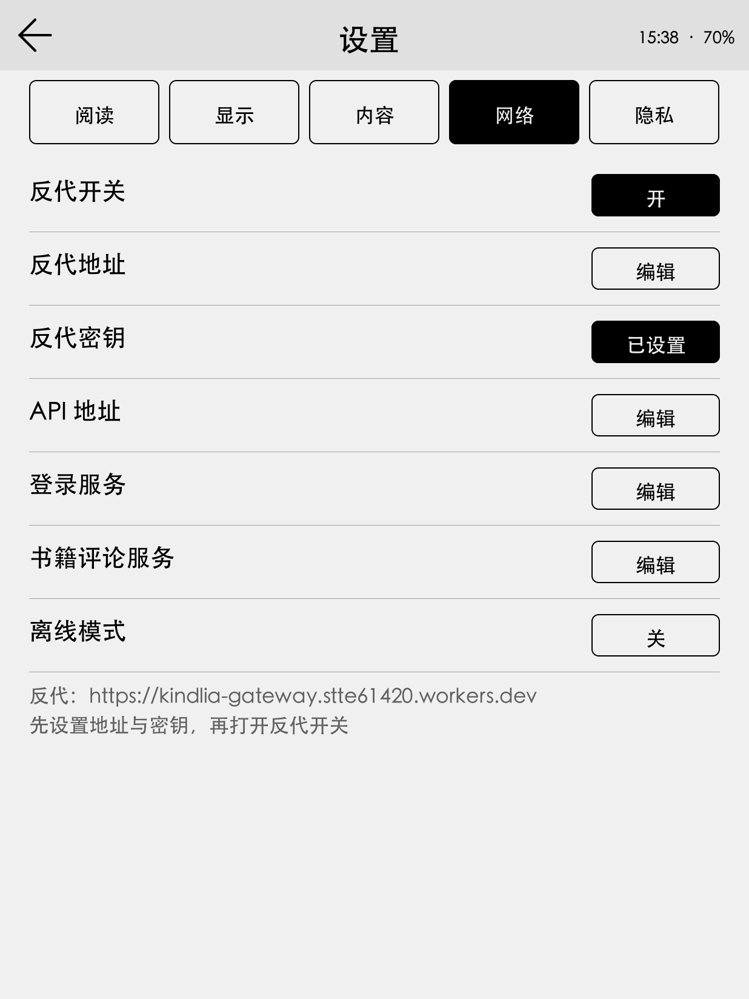
*图 30：Kindle 网络设置中确认反代开关已开启*

---

## 八、常见问题与排查指南（FAQ）

| 常见现象 / 报错 | 根本原因与解决方案 |
| --- | --- |
| **为什么不用 `workers.dev`？** | `workers.dev` 属于 Cloudflare 共享二级域名，在国内被全网 DNS 污染或 SNI 握手阻断，连接成功率极低。自定义域名能完全规避该阻断。 |
| **访问自定义域名提示证书错误？** | 新添加自定义域后，Cloudflare 需要 1~3 分钟签发 Universal SSL 证书，稍候刷新即可；并在 Cloudflare 的【SSL/TLS】中确认加密模式为 **完全 / Full**。 |
| **访问 `/health` 返回 `authenticated: false`** | 漏填了 `GATEWAY_TOKEN`，或变量仅保存在了“预览”环境未部署到“生产”环境，请返回第五步核对。 |
| **Kindle 提示 `Invalid gateway key` (HTTP 403)** | Kindle 中填写的 `gateway_key` 与 Cloudflare 中的 `GATEWAY_TOKEN` 不一致（检查是否有首尾空格或大小写误写）。 |
| **访问小说提示 `502 Upstream connection failed`** | Worker 请求小说源站超时，通常是源站瞬时高负载或网络波动，请稍等 1~2 分钟重试。 |
| **列表正常但所有小说封面图加载失败** | 检查第四步中 `IMAGE_HOSTS` 变量名与值是否完整正确，确保其未勾选 Secret。 |
| **DigitalPlat 域名到期后会扣费吗？** | 不会。DigitalPlat 提供的域名永久免费，在到期前 120 天内可免费一键续期，无需绑定任何支付方式。 |

> [!TIP]
> **连通性测试公共节点（仅供排查与临时体验）**
> 如果你在配置过程中遇到困难、想先确认 Kindle 本身网络能否连通网关，可临时使用以下测试节点（受 Cloudflare 免费配额限制，每日额度用尽即自动失效，随时可能下线，请勿作为主力阅读配置）：
> - `gateway_url`：`https://kindlia-gateway.eqnhvhiv2oyds3ajbv5ucrn8ip4t.dpdns.org`
> - `gateway_key`：`iPxAIGCTowUQgqhNuOE_Xh_fdFpROtkW`
> 
> *测试连通正常后，强烈建议按照教程搭建属于自己的专属网关，以获得长期稳定且独享的阅读体验。*
